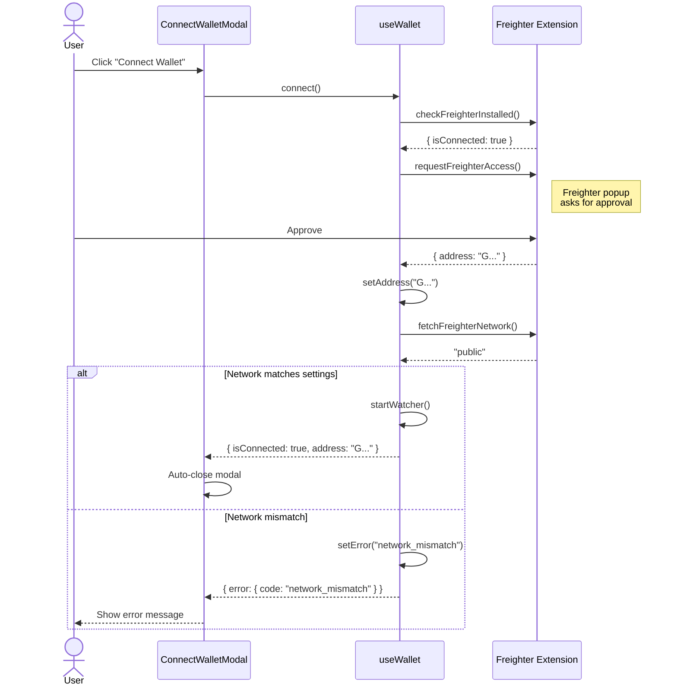
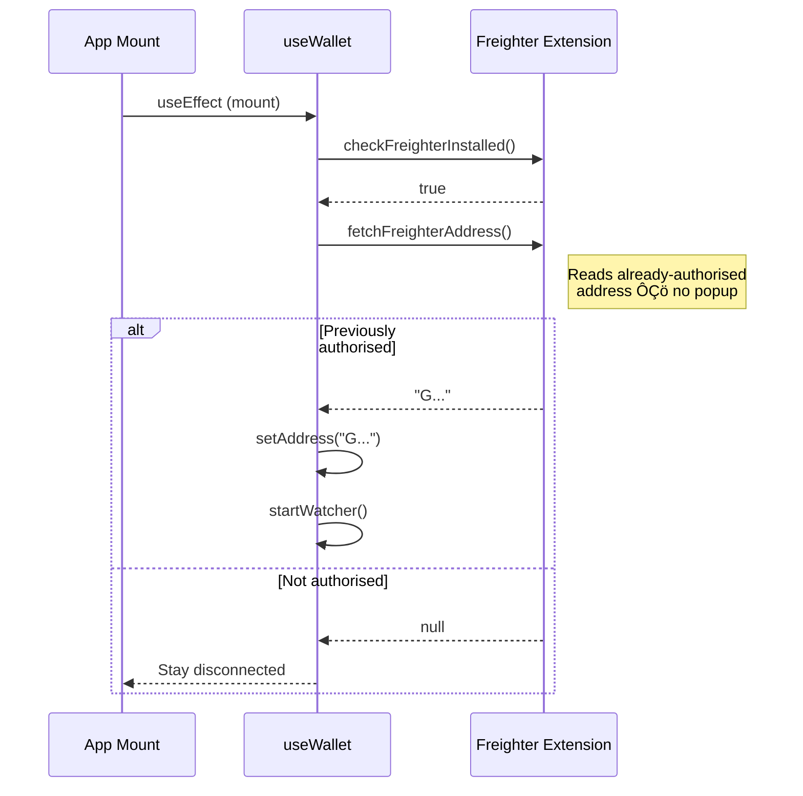
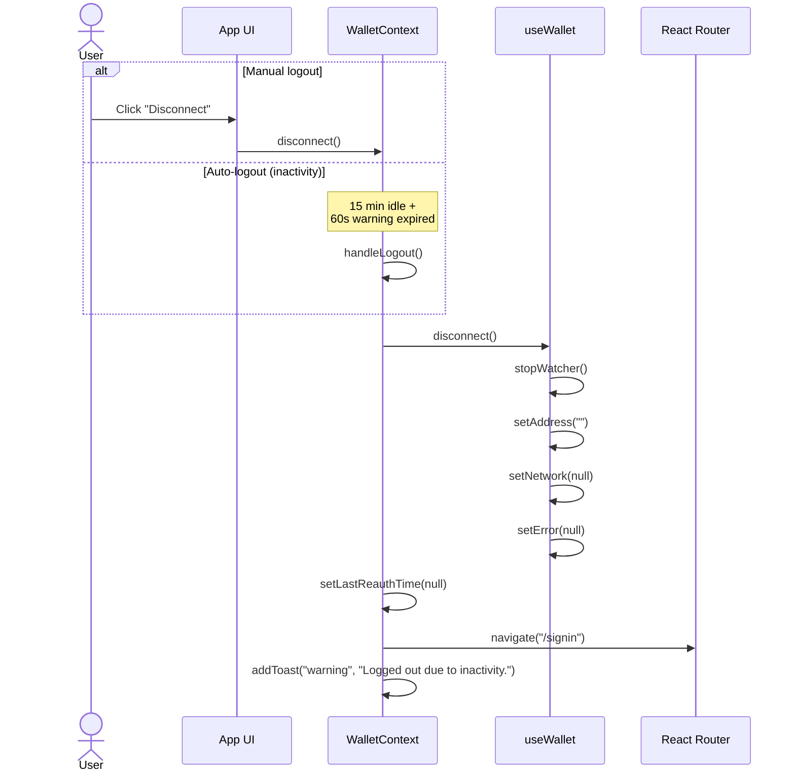
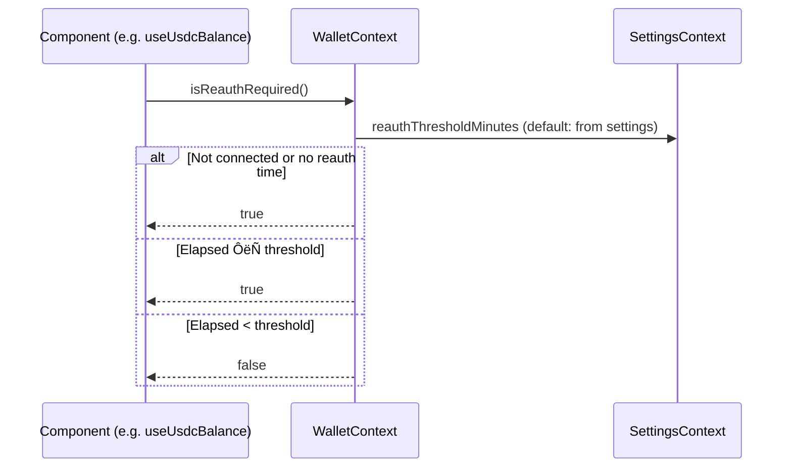
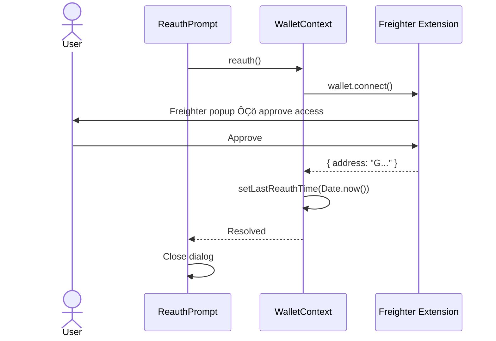
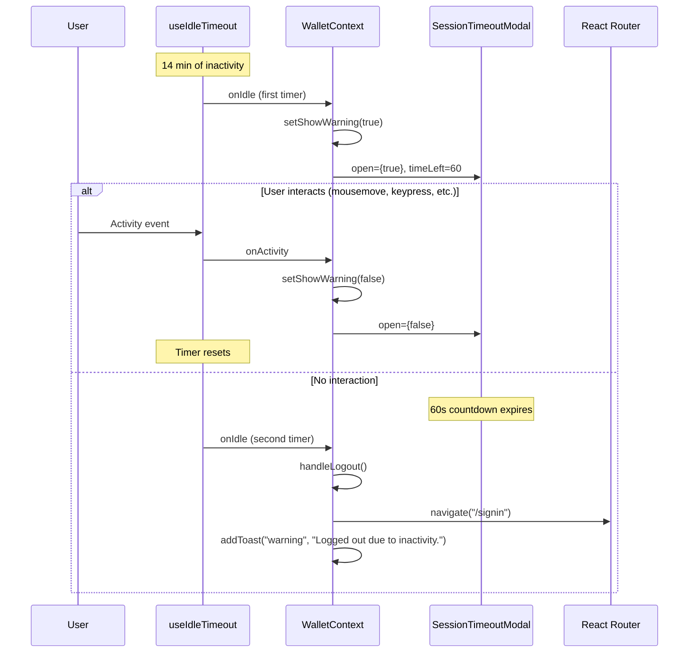

# Authentication Flows

**Audience:** Frontend contributors  
**Last reviewed:** 2026-07-26

Credence does not use username/password authentication. A user's Stellar wallet (Freighter browser extension) **is** their identity. This document describes the three session-lifecycle flows: **login (connect)**, **logout (disconnect)**, and **session refresh (re-authentication)**.

All three flows live in two layers:

| Layer | File | Responsibility |
|---|---|---|
| Low-level Freighter API | `src/lib/freighterClient.ts` | Browser-only wrappers around `@stellar/freighter-api` |
| React state machine | `src/hooks/useWallet.ts` + `src/context/WalletContext.tsx` | Exposes `connect`, `disconnect`, `reauth`, and `isReauthRequired` to the component tree |

---

## Login (Connect Wallet)

A login is a wallet connection. No credentials leave the browser ÔÇö Freighter holds the private key and only returns a public address after the user approves.

**Key code paths:**

- `src/hooks/useWallet.ts:76` ÔÇö `connect()` entry point
- `src/lib/freighterClient.ts:66` ÔÇö `requestFreighterAccess()` prompts the user
- `src/components/ConnectWalletModal.tsx:43` ÔÇö auto-closes on success

### Silent session restore

On every page load, `useWallet` tries to restore a prior session without prompting the user:

**Key code path:** `src/hooks/useWallet.ts:132`

---

## Logout (Disconnect)

A logout clears all local wallet state and stops the address watcher. It can be triggered manually by the user or automatically after inactivity.

**Key code paths:**

- `src/hooks/useWallet.ts:124` ÔÇö `disconnect()` clears local state
- `src/context/WalletContext.tsx:69` ÔÇö `handleLogout()` orchestrates the full logout including navigation and toast

---

## Session Refresh (Re-authentication)

The app enforces a configurable re-authentication threshold. When a sensitive action (e.g. viewing a USDC balance) is attempted and the threshold has elapsed since the last re-auth, the user is prompted to reconnect their wallet before proceeding.

### Threshold check

**Key code path:** `src/context/WalletContext.tsx:87`

### Re-authentication prompt

When `isReauthRequired()` returns `true`, a `ReauthPrompt` dialog is displayed. The user must click "Reconnect Wallet" to trigger the Freighter access prompt again.

**Key code paths:**

- `src/context/WalletContext.tsx:81` ÔÇö `reauth()` reconnects and resets timer
- `src/components/ReauthPrompt.tsx:51` ÔÇö dialog confirm handler

### Where re-auth is enforced

- **Balance fetches** (`src/hooks/useUsdcBalance.ts:80`) ÔÇö throws `SessionReauthRequiredError` when threshold elapsed
- **Bond creation** (`src/components/CreateBondFlow.tsx:81`) ÔÇö shows `ReauthPrompt` before proceeding

---

## Session Timeout (Inactivity Logout)

Independently of the re-auth threshold, the app enforces a hard idle timeout. After **15 minutes** of no user activity (mouse, keyboard, touch, scroll), a **60-second warning** is shown. If the user does not interact with the warning within that window, they are logged out.

**Key code paths:**

- `src/context/WalletContext.tsx:96` ÔÇö first idle timer (14 min)
- `src/context/WalletContext.tsx:111` ÔÇö second idle timer (60s warning window)
- `src/components/SessionTimeoutModal.tsx` ÔÇö countdown UI

---

## Cross-tab wallet session synchronization

Wallet session boundaries are shared across open tabs through `src/lib/crossTab.ts`.
The app prefers `BroadcastChannel` and falls back to the browser `storage` event
when BroadcastChannel is unavailable.

The originating tab publishes one of three versioned messages:

- `disconnect` when the user disconnects the wallet
- `idle-lock` when the inactivity warning expires
- `network-change` when the selected network changes

Every receiving tab ignores messages carrying its own tab id. A remote message
runs the local teardown path: pending re-authentication is cancelled, the API
identity epoch advances, the wallet disconnects, app-local storage is cleared,
an audit event is recorded with the originating correlation id, and the user is
sent to `/signin`. Receivers do not republish remote messages, preventing
cross-tab echo loops.

If BroadcastChannel is unavailable, the same message envelope is written to a
dedicated local-storage key. Other tabs receive it through the `storage` event;
the originating tab does not receive its own storage event.

## Related documents

- [Wallet Integration](./WALLET_INTEGRATION.md) ÔÇö `useWallet` hook API, connection state machine, UX contract
- [Cookie-Secret Rotation Runbook](./COOKIE_SECRETS.md) ÔÇö Backend session/CSRF cookie secret lifecycle
- [Security Headers](./SECURITY_HEADERS.md) ÔÇö Production HTTP header configuration
